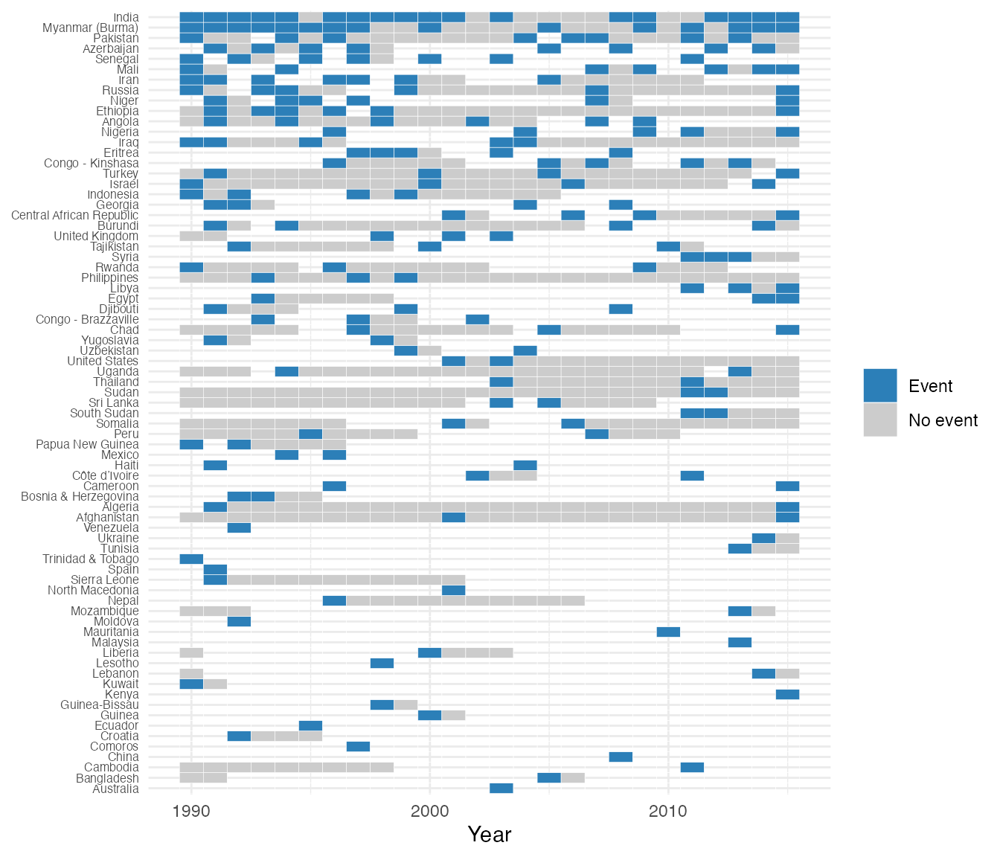

# Get started with contentiousR

`contentiousR` creates reproducible country-year panels for contentious
politics and civil conflict research, offers diagnostics and
visualization tools, and allows interoperation with `peacesciencer`.

## Build a panel and add data

First, load a package. Then, create a state panel with the selected
temporal coverage and coutnry coding system. Use a pipeline workflow to
add data, such as economic and conflict vaiables.

``` r

library(contentiousR)

panel <- build_states_panel(
  start_year = 2000,
  end_year = 2002,
  coding_system = "cow"
)

analysis_data <- panel |>
  add_gdp() |>
  add_conflict("ucdp_prio") |>
  add_leader_data("archigos")

analysis_data[1:4, c(
  "country", "year", "gdp_pcap", "ucdp_prio_incidence", "leader"
)]
#>         country year gdp_pcap ucdp_prio_incidence    leader
#> 1 United States 2000 55889.52                  NA   Clinton
#> 2 United States 2001 55783.75                   1 G.W. Bush
#> 3 United States 2002 56127.44                   1 G.W. Bush
#> 4        Canada 2000 48531.95                  NA  Chretien
```

If there is an unmatched row, R returns `NA`

## Standalone workflow

If you want to inspect data before proceeding to further steps,
standalone workflow can be helpful, as it loads data and saves it
withint R environment.

``` r

conflicts <- conflict_data(
  start_year = 2000,
  end_year = 2002,
  dataset = "ucdp_prio",
  coding_system = "gw"
)

head(conflicts)
#> # A tibble: 6 × 13
#>      gw  year ucdp_prio_incidence ucdp_prio_onset ucdp_prio_n_conflicts
#>   <int> <dbl>               <int>           <int>                 <int>
#> 1     2  2001                   1               1                     2
#> 2     2  2002                   1               0                     1
#> 3   100  2000                   1               0                     1
#> 4   100  2001                   1               0                     1
#> 5   100  2002                   1               0                     1
#> 6   200  2001                   1               1                     1
#> # ℹ 8 more variables: ucdp_prio_intensity_max <int>, ucdp_prio_war <int>,
#> #   ucdp_prio_cumulative_intensity <int>, ucdp_prio_type_max <int>,
#> #   ucdp_prio_intrastate <int>, ucdp_prio_interstate <int>,
#> #   ucdp_prio_incompatibility_max <int>, ucdp_prio_ep_end <int>
```

See
[`vignette("data-sources", package = "contentiousR")`](https://rguseinov.github.io/contentiousR/articles/data-sources.md)
before interpreting any source-specific variable.

## Conflict spells (peace-years)

[`add_spell_duration()`](https://rguseinov.github.io/contentiousR/reference/add_spell_duration.md)
helps one add peace spells, i.e. years since the last event for that
state. This tool can be useful as a control for temporal dependence
(e.g. with cubic splines). It needs a column without `NA`, so filter
first:

``` r

spell_data <- build_states_panel(1990, 2005, coding_system = "gw") |>
  add_conflict("ucdp_prio") |>
  tidyr::drop_na(ucdp_prio_onset) |>
  add_spell_duration(event = "ucdp_prio_onset")

spell_data[spell_data$gw == 2, c("gw", "year", "ucdp_prio_onset", "ucdp_prio_spell")]
#>   gw year ucdp_prio_onset ucdp_prio_spell
#> 1  2 2001               1               0
#> 2  2 2002               0               0
#> 3  2 2003               1               1
#> 4  2 2004               0               0
#> 5  2 2005               0               1
```

To work, the function needs an `event`; if it is omitted,
[`add_spell_duration()`](https://rguseinov.github.io/contentiousR/reference/add_spell_duration.md)
looks for exactly one column ending in `_onset`, `_incidence`, or
`_ongoing` and uses that; but it errors if none or several are found.

## Lagged variables

[`add_lag()`](https://rguseinov.github.io/contentiousR/reference/add_lag.md)
adds a lagged version of one or more columns, computed within each state
after sorting by year and grouping by state before lagging. Unlike a
plain dplyr::lag(), it also checks that the previous row really is the
previous year. If a year is missing, say a country has data for 2002 and
2005 but nothing in between, the lag for 2005 is set to `NA`.

``` r

build_states_panel(1990, 1995, coding_system = "cow") |>
  add_gdp() |>
  add_lag(vars = c("gdp_pcap", "gdp_growth"), n = 1) |>
  dplyr::filter(cow == 2) |>
  dplyr::select(cow, year, gdp_pcap, gdp_pcap_l, gdp_growth_l)
#> # A tibble: 6 × 5
#>     cow  year gdp_pcap gdp_pcap_l gdp_growth_l
#>   <dbl> <dbl>    <dbl>      <dbl>        <dbl>
#> 1     2  1990   45755.        NA         NA   
#> 2     2  1991   45035.     45755.         3.18
#> 3     2  1992   45912.     45035.        -1.58
#> 4     2  1993   46485.     45912.         1.95
#> 5     2  1994   47696.     46485.         1.25
#> 6     2  1995   48326.     47696.         2.60
```

Each requested variable gets one new column named `<var>_l`.

## Visualizing onsets

Use `plot_coverage` to visualize the treatment status across the panel
data. `1`s are shaded as an event, `0`s as no event, and years where the
source has no data — are left blank. States that never have the event
are dropped by default (`drop_empty = TRUE`)

``` r

if (requireNamespace("ggplot2", quietly = TRUE)) {
  build_states_panel(1990, 2015, coding_system = "cow") |>
    add_conflict("ucdp_prio") |>
    plot_coverage("ucdp_prio_onset")
}
```



## Working with V-Dem data

To work with the V-Dem data, download it from its official repository,
then use only the indicators you need:

``` r

remotes::install_github("vdeminstitute/vdemdata")

panel |>
  add_vdem(c("v2x_polyarchy", "v2x_libdem"))
```

To get started, I will provide a detailed description on two functions:
[`load_gdp_data()`](https://rguseinov.github.io/contentiousR/reference/load_gdp_data.md)
/
[`add_gdp()`](https://rguseinov.github.io/contentiousR/reference/add_gdp.md)
and
[`load_population_data()`](https://rguseinov.github.io/contentiousR/reference/load_population_data.md)
/
[`add_population()`](https://rguseinov.github.io/contentiousR/reference/add_population.md).

## `load_gdp_data()` / `add_gdp()`

Two GDP sources are curently supported and maintained: `"gapminder"` and
`"fariss"`. `"gapminder"` (default) returns `gdp_pcap`, `log_gdp_pcap`,
and `gdp_growth`. `"fariss"` returns the latent GDP and GDP per capita
estimates from Fariss, Anders, Markowitz, and Barnum (2022)

``` r

# Standalone
gdp <- load_gdp_data(start_year = 1990, end_year = 2015, coding_system = "cow")
fariss_gdp <- load_gdp_data(1700, 2015, dataset = "fariss", coding_system = "cow")

# Pipeline
panel |> add_gdp()
panel |> add_gdp(dataset = "fariss")
```

## `load_population_data()` / `add_population()`

Three population sources are available via `dataset`.

| Dataset | Source | Coverage | Returned columns |
|----|----|----|----|
| `"wpp"` (default) | [UN World Population Prospects 2024](https://population.un.org/wpp/) | 1949–2023 | `wpp_pop` |
| `"nmc"` | [Correlates of War NMC v7.0](https://correlatesofwar.org/data-sets/national-material-capabilities/) | 1816–2022 | `nmc_tpop`, `nmc_upop` |
| `"fariss"` | Fariss et al. (2022) latent estimate | 1500–2019 | `fariss_pop` |

``` r

# Standalone
pop_wpp <- load_population_data(1990, 2015, dataset = "wpp", coding_system = "cow")
pop_nmc <- load_population_data(1900, 2015, dataset = "nmc", coding_system = "cow")

# Pipeline
panel |> add_population()
panel |> add_population(dataset = "nmc")
```

## Interoperate with `peacesciencer`

`contentiousR` supports `peacesciencer` (see Miller 2022). It means you
can add data from `peacesciencer` within the same data construction
pipeline.

Functions such as
[`peacesciencer::add_archigos()`](https://rdrr.io/pkg/peacesciencer/man/add_archigos.html)
expect `ccode`/`gwcode` keys plus attributes that describe the state
system and unit of analysis. Use
[`add_from_peacesciencer()`](https://rguseinov.github.io/contentiousR/reference/add_from_peacesciencer.md)
to return a panel with only contentiousR’s original country-code key:

``` r

library(peacesciencer)

analysis_data |>
  add_from_peacesciencer(peacesciencer::add_archigos)
```

For multiple additions, call
[`as_peacesciencer_panel()`](https://rguseinov.github.io/contentiousR/reference/as_peacesciencer_panel.md)
once and then apply the `peacesciencer` functions directly.

## References

Barnum, M., Fariss, C. J., Markowitz, J. N., & Morales, G. (2025).
Measuring arms: Introducing the global military spending dataset.
Journal of Conflict Resolution, 69(2-3), 540-567.
<https://doi.org/10.1177/00220027241232964>

Fariss, C. J., Anders, T., Markowitz, J. N., & Barnum, M. (2022). New
estimates of over 500 years of historic GDP and population data. Journal
of Conflict Resolution, 66(3), 553-591.
<https://doi.org/10.1177/00220027211054432>

Miller, S. V. (2022). {peacesciencer}: An R package for quantitative
peace science research. Conflict Management and Peace Science, 39(6),
755-779. <https://doi.org/10.1177/07388942221077926>

Singer, J. David. (1988). Reconstructing the Correlates of War Dataset
on Material Capabilities of States, 1816-1985. International
Interactions, 14: 115-32.

Singer, J. David, Stuart Bremer, and John Stuckey. (1972). “Capability
Distribution, Uncertainty, and Major Power War, 1820-1965.” in Bruce
Russett (ed) Peace, War, and Numbers, Beverly Hills: Sage, 19-48.
